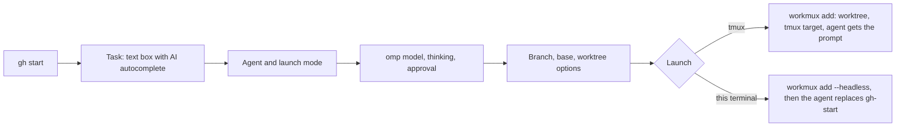

# `gh-start`

A [GitHub CLI](https://cli.github.com) extension that kickstarts a coding agent session. A
[Huh](https://github.com/charmbracelet/huh) form collects the task and session settings, then
[workmux](https://workmux.dev) creates a fresh git worktree and [omp](https://github.com/can1357/oh-my-pi)
(or another agent) starts in it with the task as its first prompt.



## Install

```sh
gh extension install prdlk/gh-start
```

Requirements:

- [workmux](https://workmux.dev) on `PATH`
- [omp](https://github.com/can1357/oh-my-pi), the default agent and the autocomplete engine. `claude`, `codex`,
  `gemini`, and `opencode` are offered as agents when installed.
- `tmux` for the tmux launch mode

## Usage

Run it from inside the repository you want to change. There are no flags; every choice is a form field
with a default, so pressing `enter` through the form starts a session:

```sh
gh start                               # empty form
gh start "Add a --json flag to list"   # task text prefilled
```

### The form

1. **Task.** Describe the change. After you pause typing, the local omp agent suggests a continuation, shown
   as ghost text under the box; `tab` inserts it. `alt+enter` / `ctrl+j` adds a new line, `ctrl+e` opens
   `$EDITOR`.
2. **Agent and launch.** The agent defaults to workmux's configured `agent:` (project `.workmux.yaml`, then
   the global config), or omp when none is set. Launch mode:
   - **tmux via workmux** (default inside tmux): runs `workmux add` with the task as the prompt file; workmux
     creates the worktree and tmux target and starts the agent there, following your workmux config
     (`mode`, `panes`/`windows`, hooks, file copies).
   - **This terminal** (default outside tmux): runs `workmux add --headless --json`, then replaces gh-start
     with the agent in the new worktree, so the omp TUI opens where you ran `gh start`.
3. **omp settings** (only when the agent is omp): model (from `omp models`), thinking level (limited to what
   the model supports), and tool approval mode. Each defaults to omp's own settings, so no flags are added.
4. **Worktree.** Branch name (blank: AI-generated from the task, via `workmux add --auto-name` in tmux mode
   or omp in terminal mode), base branch (blank: workmux `base_branch`), and options: move uncommitted
   changes, skip post-create hooks, open in background. Terminal mode only offers skipping hooks, the one
   option `workmux add --headless` supports.
5. **Confirm.** Shows the repository, branch, agent command, and the workmux command that will run. `Start`
   is preselected; `ctrl+c` aborts.

### Defaults

| Setting | Default |
| --- | --- |
| Agent | workmux `agent:`, else omp, else the first installed agent |
| Launch | tmux via workmux inside tmux, this terminal otherwise |
| omp model, thinking, approval | omp settings (no flags passed) |
| `workmux add --agent` | omitted when the agent command equals workmux `agent:` |
| Branch | AI-named from the task |
| Base | workmux `base_branch` |
| Autocomplete | on when omp is installed, using omp's fast `pi/smol` model |

Set `ACCESSIBLE` to any value to switch the form to accessible prompts.

### How autocomplete works

Each suggestion is one `omp -p` call with tools, skills, rules, context files, extensions, and sessions
disabled, thinking off, and the `pi/smol` model. The prompt holds the draft plus a short repository
summary: name, branch, top-level entries, the last 15 commit subjects, and the start of the README.
Requests are debounced (600 ms) and cancelled as soon as you type again.

## Development

```sh
go build -o gh-start .
gh extension install .   # run the local build as `gh start`
go test ./...
```

Releases: pushing a `v*` tag runs [`cli/gh-extension-precompile`](https://github.com/cli/gh-extension-precompile),
which attaches binaries for each platform to the GitHub release that `gh extension install` downloads.
